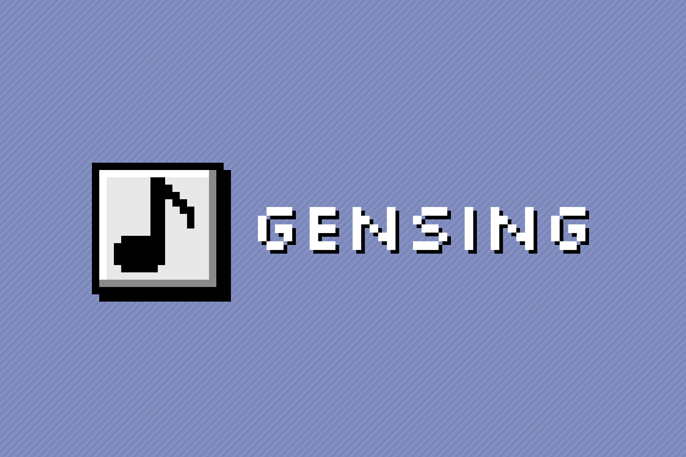

<p align="center">
  
</p>

<p align="center">
  <b>Sing a piece and see exactly where you went wrong, right on the sheet music.</b><br>
  Built in 24 hours at HackUMass XIV.
</p>

<p align="center">
  <a href="https://youtu.be/pCPp2mwTlu0"><b>▶ Watch the demo video</b></a>
</p>

---

## Why we built it

All of us are musicians, and we've all had the same problem: practicing alone, you don't always
know what you're getting wrong. A note is a little flat, an entrance is a bit late, and nobody's
there to catch it. We started with singing, where it's the hardest to hear yourself.

## What it does

Upload your sheet music and record yourself singing it. Gensing listens to the recording and gives
you the sheet music back with every note colored by how you did:

| Mark | Meaning |
|---|---|
| In tune | Right note, right pitch |
| Out of tune | Right note, but sharp or flat |
| Wrong note | You sang a different note |
| Early / late | Right note, off the beat |
| Skipped | You didn't sing it |
| Extra | You sang something that isn't written |

You also get an overall score (pitch, intonation, rhythm, completeness) and short tips on what to
work on. Click any note to hear how you sang it.

Most singing apps only show a pitch line. Gensing tells you **which** note went wrong, **how**, and
**where** in the piece.

- **Free mode** (default): sing at your own tempo; rhythm is judged against your own pulse.
- **Strict mode**: sing to the score's tempo after a one-bar count-in.
- **Starting note**: plays your first pitch so you start in the right key.

## How it works

```
sheet music ─► notes you should sing ─┐
                                      ├─► match ─► grade ─► colored score + score + tips
recording ──► pitch ─► notes you sang ┘
```

1. **Read the score.** music21 turns the sheet music into a list of expected notes.
2. **Hear the voice.** librosa's pYIN tracker follows your pitch every 10 ms, and our own algorithm
   turns that curve into the notes you actually sang.
3. **Match them up.** An edit-distance alignment (the same idea a spell checker uses) pairs sung
   notes with written ones, so one skipped or extra note doesn't throw off the rest. It also handles
   singing an octave up or down, recording delay, and notes cut in two.
4. **Grade.** Each note is checked for pitch and timing, and the results roll up into your score.
5. **Coach.** Claude reads the graded results and writes short tips. All the grading happens in our
   code; the AI only explains it. If Claude isn't reachable, rule-based tips take over.

The frontend draws the score with [OpenSheetMusicDisplay](https://github.com/opensheetmusicdisplay/opensheetmusicdisplay) and colors each notehead from the
backend's results.

## Tech stack

- **Frontend:** React, TypeScript, Vite, OpenSheetMusicDisplay, Web Audio API
- **Backend:** Python, FastAPI, music21, librosa, NumPy
- **AI:** Claude API

## Run it locally

Needs Python 3.11+ and Node 20+. From the repo root:

```bash
npm run setup   # once: installs everything
npm run dev     # starts backend (:8000) and frontend (:5001) together
```

Open http://localhost:5001 and load `samples/twinkle-twinkle/score.musicxml` to try it.

For AI tips, copy `backend/.env.example` to `backend/.env` and set `ANTHROPIC_API_KEY`. Without it,
Gensing uses the rule-based tips.

<details>
<summary>For developers</summary>

- `npm test` runs the backend tests; `npm run check:takes` runs every test recording through the
  pipeline and checks it against its answer key.
- `npm run synth` regenerates the test recordings: generated "sung" takes of each piece in
  `samples/` (perfect, with planted mistakes, an octave down, and delayed), each with an answer key.
- `contracts/` has a sample JSON for every hand-off between stages.
- Design and decisions: [`docs/DECISIONS.md`](docs/DECISIONS.md) (the spec),
  [`docs/PIPELINE_NOTES.md`](docs/PIPELINE_NOTES.md), [`docs/ALIGNMENT_EXPLAINED.md`](docs/ALIGNMENT_EXPLAINED.md).
- AI assistants: start with [`AGENTS.md`](AGENTS.md).

</details>

## What's next

- Tune the algorithm to the style of music you're singing
- Support more complex classical and opera singing
- Expand to other instruments

## Team

Jason (frontend), Jonathan (audio + server), Mehul (music logic)

## Credits

Sheet music rendering: [OpenSheetMusicDisplay](https://github.com/opensheetmusicdisplay/opensheetmusicdisplay)
(BSD-3-Clause).

Piano samples for the starting note: [Salamander Grand Piano](https://archive.org/details/SalamanderGrandPianoV3)
by Alexander Holm, [CC-BY 3.0](https://creativecommons.org/licenses/by/3.0/). MP3 copies from
[Tone.js](https://github.com/Tonejs/audio).
