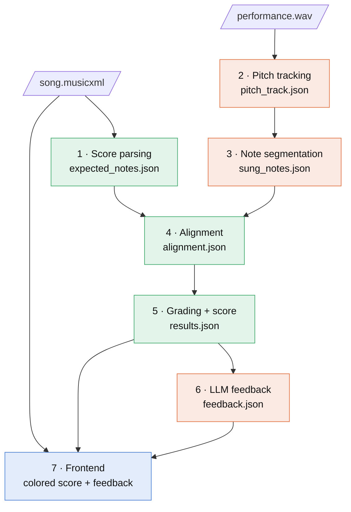

# HackUMass: Singing Feedback App — Pipeline Notes

Nov 14, 2026 · @Mehul

> Editable Markdown copy of `gensing.pdf` (17 pages, kept unchanged as the original snapshot).
> Update **this** file, not the PDF; use the PDF only for older context not covered here. [`DECISIONS.md`](DECISIONS.md) is newer and wins where they differ
> (e.g. `sids` lists instead of `sid`, 16 kHz instead of 22,050 Hz, `pitch_track` as columns).

## Overview

A singer uploads a MusicXML score, records themselves singing it, and the app marks the sheet music
note by note: wrong notes, out-of-tune notes, early or late notes, skipped notes, and extra notes. It
also gives an overall score and short AI coaching feedback.

Scope for the hackathon (team of 3, 24 hours, HackUMass XIV):

- One singing voice, no instruments
- MusicXML input only; errors are shown on the rendered sheet music
- Record first, analyze after (no live feedback)
- Two timing modes: strict (against a click) and free (against the singer's own tempo)

The one thing that must work in the demo: a colored score showing the four error types, plus an
overall score.

## Pipeline at a glance

Stage 1 (score) and stages 2–3 (audio) don't depend on each other; they meet at stage 4. Each arrow
is a JSON file handed to the next stage.

**Score side and audio side run in parallel and meet at alignment**



*pipeline · 7 stages, colored by owner: blue = A · Frontend, orange = B · Audio + server, green = C · Music logic*

The frontend also reads the MusicXML directly to draw the score, which is why note IDs must match
between stage 1 and stage 7.

## Stage 1: Score parsing

Turns the MusicXML file into an ordered list of every note the singer should sing. Every later stage
compares against this list.

**Input:** `song.musicxml`, plus the tempo (user's choice or the score's marking).

**How (Python, music21):**

1. Load the file; music21 gives a Python object of bars, notes and rests. Take the first part, top
   line only.
2. Walk bar by bar, note by note. For each: ID from bar + position (`m1-n0`), pitch as a MIDI number
   (C4 = 60), start and length in beats, rest or not, lyric.
3. Tied notes: merge into one sung note, keep both IDs in `render_ids`. Grace notes: skip. Rests:
   keep, flagged, so stage 4 can catch singing during a rest.
4. Convert beats to seconds. At 80 BPM one beat = 0.75 s. Assume a single tempo.

**Output:** `expected_notes.json`. The format is ours, not music21's; change fields as needed.

```json
{"tempo_bpm": 80, "notes": [
  {"id": "m1-n0", "measure": 1, "midi": 60, "name": "C4", "onset_beats": 0, "onset_sec": 0.0, "duration_sec": 0.75, "is_rest": false, "lyric": "A-", "render_ids": ["m1-n0"]}
]}
```

**Used by:** stage 4 (pairing), stage 5 (target pitch and time), stage 6 (bar numbers and lyrics in
feedback), stage 7 (`render_ids` to find noteheads).

**Integration point:** the browser reads the same MusicXML separately to draw it. Both sides must
count notes the same way (bar + position) or colors land on the wrong note. Test this early by
coloring every note blue from a real `expected_notes.json`.

**Simplifications:** demo pieces with no repeats, one voice, one tempo, no grace notes. Check that
pickup bars are numbered the same on both sides.

## Stage 2: Pitch tracking

Turns the recording into a pitch reading every 10 ms. No notes yet, just a curve.

**Input:** `performance.wav`, plus the time the count-in ended (in-app recordings).

**How:**

1. Clean up: convert to mono at one sample rate (e.g. 22,050 Hz), normalize volume, cut off the
   count-in so 0.0 s lines up with stage 1's 0.0 s.
2. Split into frames every 10 ms (30 s of audio = about 3,000 frames).
3. Estimate each frame's frequency, whether it's voiced (silence, breaths and consonants are
   unvoiced), and a confidence from 0 to 1.
4. Convert Hz to MIDI with decimals: `midi = 69 + 12 × log2(Hz / 440)`. 265 Hz = 60.22 = C4, 22 cents
   sharp. The decimal is what separates in tune / out of tune / wrong note.
5. Measure loudness (RMS) per frame; stage 3 uses dips to split repeated notes.

```python
f0, voiced, conf = librosa.pyin(y, sr=sr, fmin=65, fmax=1050, hop_length=220)
midi = librosa.hz_to_midi(f0)
rms = librosa.feature.rms(y=y, hop_length=220)[0]
```

**Tool choice:** pYIN (librosa) first, since it needs no extra setup. CREPE (torchcrepe, tiny model)
if curves are messy with vibrato or noise. Pitch range 65–1050 Hz (about C2–C6) covers nearly any
voice.

**Output:** `pitch_track.json` (arrays in code):

```json
{"hop_sec": 0.01, "frames": [
  {"t": 0.02, "midi": 59.97, "voiced": true, "conf": 0.93, "rms": 0.31}
]}
```

**Used by:** stage 3 (only consumer of the curve); stage 7 pitch view (optional).

**Watch for:** octave errors (the curve jumps exactly 12 semitones for a few frames), noise creating
fake voiced frames, and vibrato (normal, ±30–50 cents). Plot this curve before writing anything else;
it's the main debugging tool.

## Stage 3: Note segmentation

Cuts the pitch curve into a list of sung notes, each with start, end and one pitch value. It doesn't
look at the score: it answers "what did they actually sing?"

**Input:** `pitch_track.json`.

**How:**

1. Drop unreliable frames (confidence under ~0.5 or very quiet).
2. Smooth with a ~50 ms median filter to remove spikes and octave jumps.
3. Split at unvoiced gaps (breaths, rests, consonants).
4. Inside each voiced stretch, start a new note when pitch moves more than ~0.5 semitone and stays
   there at least ~50 ms (so vibrato doesn't split notes).
5. Split same-pitch repeats using loudness dips and `librosa.onset.onset_detect`.
6. Drop pieces under ~80 ms; merge neighbors on the same pitch with no real break.
7. Summarize each note: start, end, median pitch of the middle ~60% (ignores scoops in and out),
   stability (pitch spread in cents), average confidence.

**Output:** `sung_notes.json`:

```json
{"notes": [
  {"sid": "s1", "start_sec": 0.81, "end_sec": 1.42, "midi": 61.71, "stability_cents": 14, "conf": 0.90}
]}
```

**Tuning knobs (starting values):**

| Knob | Start | Too low | Too high |
|---|---|---|---|
| Confidence cutoff | 0.5 | noise becomes notes | quiet notes vanish |
| Pitch change for new note | 0.5 semitone | vibrato splits notes | fast steps merge |
| Time new pitch must hold | 50 ms | vibrato splits notes | fast passages merge |
| Minimum note length | 80 ms | blips count as notes | short notes dropped |

**Used by:** stage 4 (pairing), stage 5 (pitch, start time, stability), stage 7 (sung notes as bars in
the pitch view).

**Risk:** the most fragile stage. One note split in two looks like an extra note; two merged look like
a skip. Always plot detected notes over the curve, and pick friendly demo pieces.

## Stage 4: Alignment

Decides which sung note goes with which written note. Each written note ends up matched or skipped;
each leftover sung note is extra. If this goes wrong, one missed note makes everything after it red.

**Input:** `expected_notes.json`, `sung_notes.json`, mode (strict / free).

**How:**

1. **Octave shift:** find the most common gap between sung and written pitches, round to −12, 0 or
   +12, and subtract it. Any-key transposition is an optional setting.
2. **Rough tempo scaling (free mode only):** stretch sung times so total length matches the score's.
3. **Sequence alignment (edit-distance style):** fill a table, rows = written notes, columns = sung
   notes. Each cell = lowest total penalty for handling that many of each. Three moves into a cell:
   pair (↖, cost = semitones apart, capped at 4, plus a little for time difference), written note
   skipped (↑, cost 3), extra sung note (←, cost 3). Take the cheapest; trace arrows back from the
   bottom-right corner to read off the pairs.
4. **Rests and splits:** an extra note inside a rest = "sang during rest". Two same-pitch sung notes
   around one written note = merge back into one match (fixes the most common stage 3 error).

**Worked example** (written C D E, sung C E, skip = extra = 3):

| | nothing sung | sung C | sung E |
|---|---|---|---|
| nothing written | 0 | 3 | 6 |
| written C | 3 | **0** (pair) | 3 |
| written D | 6 | **3** (skip D) | 2 |
| written E | 9 | 6 | **3** (pair) |

Tracing back gives: C matched, D skipped, E matched, total 3. Pairing in order (D with E, then E
skipped) would cost 5, so it loses.

**Cost rule that matters:** a small pitch error (1–2 semitones) must cost less than skip + extra (6).
Then a wrong-but-present note comes out as a match that stage 5 labels "wrong note", not as a skip
plus an extra.

**Output:** `alignment.json` (pairings only, no judgments):

```json
{"octave_shift": -12, "tempo_scale": 1.0, "pairs": [
  {"type": "match", "id": "m1-n0", "sid": "s0"},
  {"type": "skipped", "id": "m1-n1", "sid": null},
  {"type": "extra", "id": null, "sid": "s3", "near_id": "m2-n0"}
]}
```

**Used by:** stage 5 (judges every pair), stage 7 (skipped and extra markers; `near_id` places
extras).

**Fallback, DTW (dynamic time warping):** the same table idea, but it compares the pitch curve itself
to the score as a curve, step by step. Its moves are pair, stretch and squeeze, with no skip or extra.
It doesn't need stage 3, because it uses the score to decide where each note landed, and it handles
tempo changes well. But it can't report skipped or extra notes directly (a skipped note gets squeezed
onto a sliver of audio). Use it only if stage 3 proves unreliable.

## Stage 5: Grading and scoring

Judges every pair from stage 4, computes the overall score, and finds patterns for the feedback. This
is the first stage that makes judgments; earlier stages only measure.

**Input:** `alignment.json`, `expected_notes.json`, `sung_notes.json`, mode, threshold preset.

**Per-note verdicts.** Pitch and timing are judged separately, so a note can be both flat and late.

| Check | Rule (starting values) | Verdict |
|---|---|---|
| Skipped / extra | copied from stage 4; an extra inside a rest = "sang during rest" | skipped / extra |
| Pitch | deviation = (sung − octave shift − written) × 100 cents; within ±25 | in tune |
| Pitch | 25–50 cents off | out of tune (flat or sharp) |
| Pitch | over 50 cents off (closer to another note) | wrong note, plus which note was sung |
| Timing | start within ±⅛ beat, minimum 80 ms | on time |
| Timing | outside that window | early or late |
| Confidence | stage 3 confidence low | uncertain (not penalized) |

**What timing is measured against:**

- Strict: the start time from stage 1, set by the click.
- Free: a straight line through the note's neighbors (about 4 before and 4 after), plotting beat
  position against actual time. A note is early or late only if it sticks out from that line, so
  gradual slowing is fine.
- Both modes: subtract the singer's median offset first. This cancels browser recording delay (often
  50–150 ms) and the consonant-before-vowel effect.

**Overall score** (weights are a first guess; adjust until it feels fair):

| Part | How | Weight |
|---|---|---|
| Pitch accuracy | % of written notes sung on the right note | 40% |
| Intonation | average cents off on right notes: 0 → 100, 50 → 0 | 20% |
| Rhythm | % of matched notes on time | 25% |
| Completeness | % not skipped, minus a small penalty per extra | 15% |

**Patterns** (computed here so the LLM never does math): worst bars, pitch drift (first third vs last
third), high notes flatter than low, average rushing or dragging, shaky long notes, errors right after
leaps of 4+ semitones.

**Output:** `results.json`:

```json
{"score": {"total": 78, "pitch": 85, "intonation": 70, "rhythm": 72, "completeness": 90},
 "notes": [{"id": "m1-n1", "status": "out_of_tune", "cents": -29, "direction": "flat", "timing_ms": 140, "timing": "late"}],
 "extras": [{"sid": "s3", "near_id": "m2-n0", "sang": "E4", "during_rest": false}],
 "patterns": {"worst_measures": [5, 6], "drift_cents": {"first_third": -4, "last_third": -27}, "high_notes_flat": true}}
```

**Settling thresholds:** record the demo piece sung well (should be mostly green) and sung with
deliberate mistakes (every one should be caught). Tune until both pass. Optional presets: Beginner
(±35 cents, ±¼ beat) and Advanced (±15 cents, ±1/16 beat).

**Used by:** stage 6 (score, patterns, problem notes), stage 7 (colors, markers, score card).

## Stage 6: LLM feedback

Turns stage 5's numbers into a short coaching note: what went well, the 2–3 biggest problems, and how
to practice each. The LLM adds no analysis; it only explains what stage 5 already found.

**Input:** a trimmed `results.json`: piece info (title, tempo, mode, preset), `score`, `patterns`, and
only the problem notes (cap ~30), each with bar number, note name and lyric.

**How:**

1. Backend builds the prompt: "You are a supportive vocal coach. Use ONLY these facts; do not invent
   errors or numbers." Ask for JSON, max 3 tips, under 150 words.
2. Call a fast, cheap model (check for sponsor API credits).
3. Validate: parse the JSON and reject tips citing bars that don't exist. Retry once, then use the
   fallback.

**Output:** `feedback.json`:

```json
{"summary": "Solid first run: you hit 85% of the notes.",
 "strengths": ["Opening phrase was in tune and on time"],
 "tips": [{"title": "You drift flat as you go", "explanation": "...", "exercise": "Sing bars 5–6 slowly against a drone on D.", "measures": [5, 6]}]}
```

**Reliability:**

- Separate API call, so the colored score shows first and feedback loads after.
- Rule-based fallback: a few `if` rules that turn `patterns` into sentences. About 20 minutes of work;
  saves the demo if Wi-Fi or the API fails.
- `measures` makes each tip clickable in the UI, tying the feedback to the sheet music.

**Used by:** stage 7 feedback panel.

## Stage 7: Frontend

Shows everything on the actual sheet music. This is what judges see.

**Input:** `song.musicxml`, `results.json`, `feedback.json` (arrives later), optionally
`pitch_track.json` and `performance.wav`.

**Screens:**

1. **Setup:** upload MusicXML (score draws right away), choose mode, tempo and preset, or upload a
   recording instead.
2. **Record:** still score, record button, one-bar count-in, click continues in strict mode
   (headphones). Web Audio API for the click, MediaRecorder for the mic. Send the exact count-in end
   time to the backend.
3. **Results:** colored score, score card, coach panel, pitch view.

**How coloring works:**

1. Draw the score with OpenSheetMusicDisplay (it produces SVG shapes).
2. Walk the drawn notes bar by bar and build the same IDs as stage 1.
3. Color each notehead from `results.json` (set the note's color and redraw, or change the SVG fill).
   Color every ID in `render_ids` for ties.
4. Place markers over the score at each notehead's screen position: ↑/↓ for sharp/flat, early/late
   markers, "sang C#" labels, ✕ for skipped, + for extras next to `near_id`.
5. Hover shows exact numbers ("D5 · 38 cents flat · 140 ms late").

| Result | How it shows |
|---|---|
| Correct | green notehead |
| Out of tune | yellow + ↑/↓ arrow |
| Wrong note | red + "sang C#" label |
| Early / late | small marker above the note (color stays with pitch) |
| Skipped | grey or hollow notehead with ✕ |
| Extra | small red + between neighboring notes |

**Results layout:** score on the left; score card (total + four parts) and coach panel on the right,
where clicking a tip highlights and scrolls to its bars; pitch view along the bottom, with expected
notes as bars and the singer's voice as a line.

**API between frontend and backend:**

```
POST /analyze   musicxml + audio + settings  →  results.json   (stages 1–5)
POST /feedback  results.json                 →  feedback.json  (stage 6)
```

Splitting them lets the score appear before the AI feedback is ready.

**First task, before any audio code exists:** color every note from a fake `results.json` and check
each color and marker lands on the right notehead.

## Decide before we start

Settle these together at the start. Everything else can be decided by whoever owns that stage.

- [ ] **JSON formats:** agree on the exact fields of `expected_notes`, `pitch_track`, `sung_notes`,
  `alignment`, `results` and `feedback` (start from the examples in this doc). Commit them to
  `/contracts`.
- [ ] **Note ID scheme:** bar + position in bar; how ties, rests and pickup bars are counted. Frontend
  and score parsing must match exactly.
- [ ] **Time zero:** 0.0 s = first beat after the count-in, in every file. Uploaded recordings use the
  first sung note as beat 1. *(Changed: stage 4 now measures the offset from the matched notes,
  `time_offset_sec`; see DECISIONS.md section 3.)*
- [ ] **Units:** pitch as MIDI float, deviations in cents, times in seconds, timing errors in ms.
- [ ] **Demo pieces:** pick 1–2 (slow, no repeats, few same-pitch repeats) and get their MusicXML.
- [ ] **Test recordings:** each piece sung well, and sung with deliberate mistakes (one wrong note, one
  flat, one late, one skipped). These are the answer key and the demo backup.
- [ ] **Stack and repo:** Python backend (FastAPI, librosa, music21), web frontend with
  OpenSheetMusicDisplay; one repo, how to run locally.
- [ ] **API shape:** `/analyze` and `/feedback` request and response formats.
- [ ] **Roles:** who owns which stages (next section).
- [ ] **Decision maker:** one person who makes the call on cuts when time runs short.

## Dividing the work

Split by stages, so each person owns whole stages and the JSON files are the hand-offs. B and C share
the Python backend repo; A works in the frontend.

| Role | Stages | Builds | Produces | Pairs with |
|---|---|---|---|---|
| A: Frontend | 7 + in-app recording | setup, record and results screens; score drawing, coloring, markers; score card; coach panel; pitch view | the app | C on the note-ID scheme |
| B: Audio + server | 2, 3, 6 + API | audio cleanup and trimming, pitch tracking, segmentation, `/analyze` and `/feedback` endpoints, LLM call + fallback | `pitch_track.json`, `sung_notes.json`, `feedback.json` | C on `sung_notes` format and the split-note merge |
| C: Music logic | 1, 4, 5 | MusicXML parsing, alignment, grading, overall score, patterns | `expected_notes.json`, `alignment.json`, `results.json` | A and B |

Who takes which role is still open; match it to who is strongest at frontend, audio/signal work, and
algorithms.

## Dependencies and working independently

The JSON files are the only connections between people, so nobody has to wait if each person commits
a hand-made sample of their output on day one. Downstream work builds against the fake and switches to
the real file when it arrives.

| Who needs it | What | Comes from | Until it's real, use |
|---|---|---|---|
| A (frontend) | `results.json` | C, stage 5 | hand-made verdicts for every note of the demo piece |
| A (frontend) | `feedback.json` | B, stage 6 | a hand-written sample with 2 tips |
| A (frontend) | note IDs that match the drawn score | C, stage 1 | real `expected_notes.json` early; this is the first joint test |
| B (stage 3) | `pitch_track.json` | B, stage 2 | none needed; same person |
| B (stage 6) | `results.json` | C, stage 5 | same fake A uses |
| C (stage 4) | `sung_notes.json` | B, stage 3 | hand-typed lists (e.g. C D E with D removed) |
| C (stage 4) | `expected_notes.json` | C, stage 1 | none needed; same person |
| Everyone | test recordings + demo MusicXML | all, at the start | required before real testing |

**Can run fully in parallel:** stage 1 vs stages 2–3 (score side vs audio side); frontend score
drawing vs all backend work.

**Must happen in order:** stage 4 needs stages 1 and 3; stage 5 needs 4; stage 6 needs 5; the real
results screen needs 5.

**Joint checkpoints:**

1. **ID check (A + C):** C's real `expected_notes.json` colors every notehead correctly in A's
   renderer.
2. **Format check (B + C):** B's real `sung_notes.json` on a test recording loads into C's alignment
   without changes.
3. **First end-to-end run (all):** test recording → colored score, even if ugly and partly wrong.
   Highest-priority milestone; everything after is tuning.
4. **Threshold tuning (B + C):** good recording mostly green, every deliberate mistake caught.

## Nice-to-haves and what to cut

> The live, editable list is [`NICE_TO_HAVE.md`](NICE_TO_HAVE.md); new ideas go there.

Nice-to-haves, in priority order (only after the core works end to end):

1. **Click a note to hear it:** plays your recording from that note, so you hear exactly what you did
   wrong and where (uses the sung note's start time). About an hour; very convincing for judges.
2. **Pitch view:** expected notes as bars, the singer's voice as a line; flat notes visibly sit under
   their bars.
3. **Beginner / Advanced threshold presets.**
4. **Repeats:** on upload, unfold repeats with music21 (`expandRepeats()`) and save a new MusicXML that
   both stage 1 and the frontend use, so each pass is drawn and colored separately. Store the original
   bar number and pass (`"orig_measure": 3, "pass": 2`) so feedback says "bar 3, second time". Show
   the unfolded score while recording too. Check early that the exported file renders correctly and
   that each pass has the right verse's lyrics.
5. **Playback with a moving highlight** across the score.
6. **"Ask the coach"** follow-up questions, with `results.json` as context.
7. **Retry a bar:** re-record only the worst bars.
8. **Any-key transposition** setting (beyond octave shifts).
9. **Lyrics, texture and breath score:** check diction (were the right syllables sung), tone quality,
   and whether breaths land in sensible places. Each needs new analysis beyond pitch and timing.
10. **Scan any sheet music:** accept a PDF or photo and convert it to MusicXML with optical music
    recognition (Audiveris or oemer) before stage 1.

If behind schedule, cut in this order: retry-a-bar, Ask the coach and playback highlight; then pitch
view; then free tempo mode (keep strict); then the LLM call (rule-based fallback covers it); then
in-app recording (upload only).

Never cut: the colored score, the four error types, and the overall score.

## Risks and testing

| Risk | Stage | Mitigation |
|---|---|---|
| Segmentation splits or merges notes | 3 | Plot notes over the curve; split-note merge in stage 4; friendly demo pieces; DTW fallback |
| Colors land on wrong noteheads | 1 + 7 | Shared ID scheme; color-everything test early |
| Everything looks late in strict mode | 2 + 5 | Subtract median offset (recording delay, consonants) |
| Mic picks up the click | 7 | Headphones while recording |
| Noisy venue ruins live demo | demo | Close mic or headset; pre-recorded backup; screen recording of a working run |
| LLM slow, down, or makes things up | 6 | Separate call; trimmed facts-only prompt; rule-based fallback |
| Thresholds feel unfair | 5 | Tune on the good and deliberate-mistake recordings |

**Testing approach:** the two test recordings per piece are the answer key. After any change to
stages 2–5, re-run both: the good take should stay mostly green and every deliberate mistake should
still be caught.

## Alternatives we turned down

| Option | Why not (for now) | Revisit if |
|---|---|---|
| PDF or photo upload via OMR (Audiveris, oemer) | Slow, error-prone; OMR mistakes look like singer mistakes; could eat the whole weekend | Everything else works and there's spare time; or say "export from MuseScore" |
| Live feedback with a moving cursor | Needs streaming pitch tracking and online alignment | Post-hackathon |
| Matching notes in plain order | One skip or extra shifts every later pair | Never |
| DTW (curve vs score) as the main alignment | Can't report skipped or extra notes directly | Stage 3 segmentation proves unreliable |
| basic-pitch for pitch tracking | Built for several simultaneous notes; we only have one voice | Instruments get added |
| Unfolding repeats | One written note sung twice; unclear which result to color it with | Core works; plan is under Nice-to-haves (unfold and render each pass) |
| Letting the LLM analyze raw data | LLMs are bad at arithmetic and may invent trends | Never; stage 5 computes, LLM explains |

## Decisions made

These came out of the planning discussion. Change them deliberately, not by drift.

| Topic | Decision | Why |
|---|---|---|
| Score input | MusicXML (exported from MuseScore or downloaded) | Exact pitches and durations; PDF via OMR would eat the whole weekend and its errors look like the singer's errors |
| Showing errors | Draw the score in the browser with OpenSheetMusicDisplay and color individual noteheads | Each note is its own shape we can style; can't do that on a PDF image |
| Live vs offline | Record first, then analyze | Far simpler; one pass over the full recording |
| Timing modes | Support both strict (click track) and free tempo; build strict first | Same alignment for both; only the timing reference differs, so free mode is cheap |
| Recording | Record inside the app (count-in + click), with file upload as a fallback | App knows exactly where beat 1 is; upload covers the backup demo recording |
| Click during recording | Singer wears headphones | Otherwise the mic picks up the click and pitch tracking follows it |
| Note IDs | Bar number + position in bar (`m3-n2`), built the same way in backend and frontend | Lets backend results land on the right notehead |
| Pitch tracker | Start with pYIN (librosa); switch to CREPE only if curves look bad | pYIN needs no extra setup |
| Alignment | Note-to-note alignment with match / skip / extra penalties | Reports skipped and extra notes directly |
| Octave | Detect an octave shift (−12, 0, +12) before grading *(changed: ±24 too, e.g. a soprano singing a bass line; see DECISIONS.md 4.4)* | A baritone singing a treble melody shouldn't be all red |
| Overall score | Yes: total plus four parts (pitch, intonation, rhythm, completeness) | Judges like a number; the breakdown makes it believable |
| AI feedback | Yes, as an optional last stage, with a rule-based fallback | Readable coaching; demo survives if the API fails |
| Thresholds | Starting values below, tuned using our own test recordings; optional Beginner/Advanced presets | We don't know good values yet, so we measure |
| Demo pieces | Slow, no repeats, few same-pitch repeated notes | Avoids the hardest cases in parsing and segmentation |
